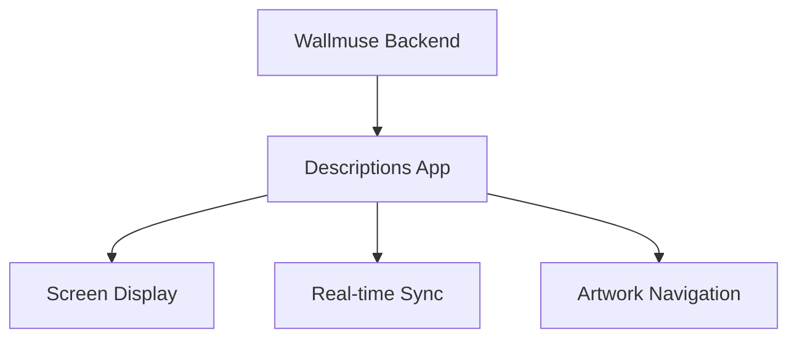

# Wallmuse Descriptions App Architecture

## 1. Overview

The Descriptions App is a React-based real-time display application that shows artwork information
for specific screens within the Wallmuse ecosystem. It provides a synchronized view of current
artwork details including images, descriptions, and metadata.



## 2. Core Architecture

### 2.1 Application Structure

```
Descriptions App
├── API Layer (src/utils/api.js)
├── Theme System (src/theme/)
├── Utilities (src/utils/Utils.js)
├── Internationalization (src/i18n.js)
└── Main App Component (src/App.js)
```

### 2.2 Data Flow

```
URL Parameters (screen, artwork_id?)
└── API Fetch (currentArtworks)
    └── XML to JSON Conversion
        └── Timing Calculation
            └── Real-time Display Updates (normal mode)
                or Pinned Artwork Display (artwork_id mode)
```

## 3. Key Components

### 3.1 Main App Component (`src/App.js`)

**Purpose**: Primary container managing state and rendering **Key Features**:

- Real-time artwork synchronization
- Navigation controls (previous/next)
- Timeline slider for manual navigation
- Automatic artwork transitions based on timing

**State Management**:

- `artworks`: Processed artwork data with timing
- `currentArtworkIndex`: Current displayed artwork index
- `counter`: Elapsed time counter for synchronization
- `duration`: Total playlist duration
- `pinnedArtworkId`: Set from `?artwork_id=` URL param; enables pinned mode (see §5.3)

### 3.2 API Layer (`src/utils/api.js`)

**Purpose**: Backend communication and data processing **Key Functions**:

#### `detailsUser()`

- Fetches user account, house, environments, and screen data
- Returns structured user context for the application

#### `currentArtworks(screen)`

- Fetches artwork data for specific screen
- Converts XML response to JSON
- Processes timing calculations
- Returns array of artworks with metadata

### 3.3 Theme System (`src/theme/ThemeUtils.js`)

**Purpose**: Dynamic theming based on subdomain **Supported Themes**:

- `wallmuse` (default)
- `sharex`
- `ooo2`

**Theme Selection Logic**:

```javascript
subdomain = URL.split('//')[1]?.split('.')[0];
theme = subdomain || 'wallmuse';
```

### 3.4 Utilities (`src/utils/Utils.js`)

**Purpose**: Common utility functions **Key Functions**:

- `getUserId()`: Extracts user session from DOM or URL
- `wmm_url`: Current domain URL
- `rootElementId`: DOM element identifier

## 4. Data Structure

### 4.1 Artwork Object

```javascript
{
  id: string,             // Maps to artwork_id XML attribute
  title: string,
  startTime: number,      // Calculated timing
  endTime: number,        // Calculated timing
  datation_start: string,
  datation_end: string,
  datation_kind: string,
  author: string,
  description: string,    // HTML content
  location: string,
  owner: string,
  capture: string,
  image_url: string,
  credits: Array<{ kind: string, name: string, display_name: string }>
  // Credit kinds: AUT (author), PHO (photographer), REP (representative), OWN (owner)
}
```

### 4.2 Timing Calculation

```javascript
// Sequential timing calculation
let startTime = 0;
artworks.map(artwork => {
  const duration = parseFloat(artwork.duration);
  const offset = parseFloat(artwork.offset);
  const endTime = startTime + duration + offset;

  startTime = endTime; // Next artwork start time
  return { ...artwork, startTime, endTime };
});
```

## 5. Real-time Synchronization

### 5.1 Time Tracking System

- **Counter Updates**: Every 1000ms interval
- **Artwork Transitions**: Automatic when `counter >= artwork.endTime`
- **Loop Behavior**: Resets counter and cycles through artworks

### 5.2 Server Re-sync (every 30 s)

In normal mode the app re-fetches `serverPosition` from the backend every 30 seconds and re-anchors `startTimeRef` without triggering a re-render. This corrects clock drift that accumulates when the player or the descriptions app is refreshed independently. Re-sync is disabled in pinned mode.

### 5.3 Pinned Artwork Mode

**URL:** `?screen=XXXX&artwork_id=14670`

When `artwork_id` is present the app locks to that specific artwork on load:

- Auto-advance is disabled — the visitor stays on the pinned artwork until they navigate manually with the prev/next arrows.
- The timeline slider is hidden.
- Server re-sync (§5.2) is disabled.
- `screen` is still required — the backend needs a valid screen to return the playlist; `artwork_id` then pins within that playlist.

**Use case:** Permanent QR codes placed on physical artworks in a gallery or public space. Scanning the code shows the description, credits, and metadata for that specific work regardless of what is currently playing on the screen.

The `artwork_id` value must match the `artwork_id` XML attribute returned by the backend (not an internal database id).

## 6. User Interface

### 6.1 Layout Structure

```
Grid Container (100vh)
├── Previous Button (2 cols)
├── Artwork Display (8 cols)
│   ├── Title
│   ├── Datation
│   ├── Image
│   ├── Author
│   ├── Description (scrollable)
│   └── Footer (Location/Owner/Capture)
└── Next Button (2 cols)
└── Timeline Slider (12 cols)
```

### 6.2 Navigation Features

- **Manual Navigation**: Previous/Next buttons
- **Timeline Slider**: Direct time position selection
- **Auto-scroll**: Smooth scroll to active artwork
- **Responsive**: Material-UI Grid system

## 7. Integration with Wallmuse Ecosystem

### 7.1 URL Parameters

| Parameter | Required | Description |
|-----------|----------|-------------|
| `screen` | Yes | Identifies the display target; passed to `currentArtworks(screen)` |
| `artwork_id` | No | Pins the display to a specific artwork (see §5.3) |

Example — normal mode: `?screen=abc123`  
Example — pinned mode: `?screen=abc123&artwork_id=14670`

### 7.2 Session Management

- **User Session**: Retrieved via `getUserId()`
- **Backend URL**: `https://wallmuse.com:8443/wallmuse/ws`
- **Authentication**: Session-based API calls

## 8. Deployment Configuration

### 8.1 Build Configuration

```json
{
  "scripts": {
    "start": "react-scripts start",
    "build": "react-scripts build",
    "test": "react-scripts test"
  }
}
```

### 8.2 Dependencies

- **React 18.2.0**: Core framework
- **Material-UI**: UI components and theming
- **Axios**: HTTP client for API calls
- **xml-js**: XML to JSON conversion
- **react-i18next**: Internationalization

## 9. Known Issues and Improvements

### 9.1 Time Synchronization

**Implemented:**

- 30-second server re-sync corrects drift in normal mode (§5.2)
- Initial position anchored to `serverPosition` from backend on load

**Remaining limitations:**

- Browser tab focus: intervals may pause when the tab loses focus for extended periods
- Network latency on the re-sync call is not compensated

### 9.2 Performance Considerations

**Current**:

- Interval-based updates every 1000ms
- Full artwork array processing on each update

**Improvements**:

- Event-driven updates instead of polling
- Memoization for expensive calculations
- Virtual scrolling for large artwork lists
- Image preloading optimization

### 9.3 Error Handling

**Current**:

- Basic try-catch blocks
- Console logging for debugging

**Improvements**:

- User-friendly error messages
- Retry mechanisms for API failures
- Graceful degradation for missing data
- Error boundary components

## 10. Development Guidelines

### 10.1 Code Conventions

- **File Structure**: Follow existing component organization
- **Naming**: Use descriptive variable names with artwork context
- **Styling**: Material-UI theme system integration
- **State Management**: React hooks for local state

### 10.2 API Integration

- **Error Handling**: Always wrap API calls in try-catch
- **Response Validation**: Check for expected data structure
- **Logging**: Include relevant debugging information
- **Session Management**: Use provided `getUserId()` utility

### 10.3 Testing Considerations

- **Screen Parameters**: Test with various screen IDs
- **Timing Edge Cases**: Test artwork transitions
- **Error Scenarios**: Test network failures and invalid data
- **Cross-browser**: Verify timing accuracy across browsers

## 11. Future Enhancements

### 11.1 Real-time Synchronization

- WebSocket connection for server push updates (polling currently)
- Network latency compensation on re-sync
- Credits display — wired in UI but commented out pending backend fix on credit field data

### 11.2 Enhanced User Experience

- Add artwork transition animations
- Implement gesture-based navigation
- Include accessibility improvements
- Add fullscreen mode support

### 11.3 Performance Optimization

- Implement virtual scrolling for large datasets
- Add image lazy loading and preloading
- Optimize rendering with React.memo
- Add service worker for offline capability

---

_Generated for Wallmuse Descriptions App - Real-time artwork display system_
