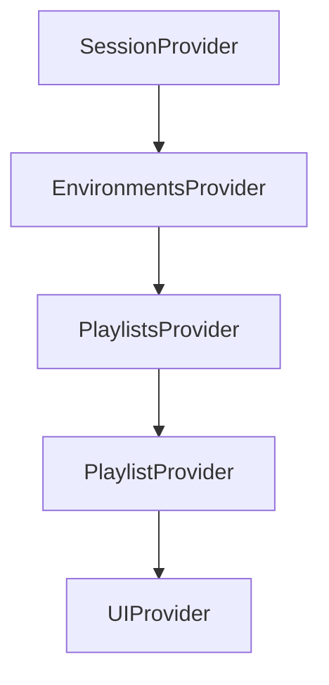
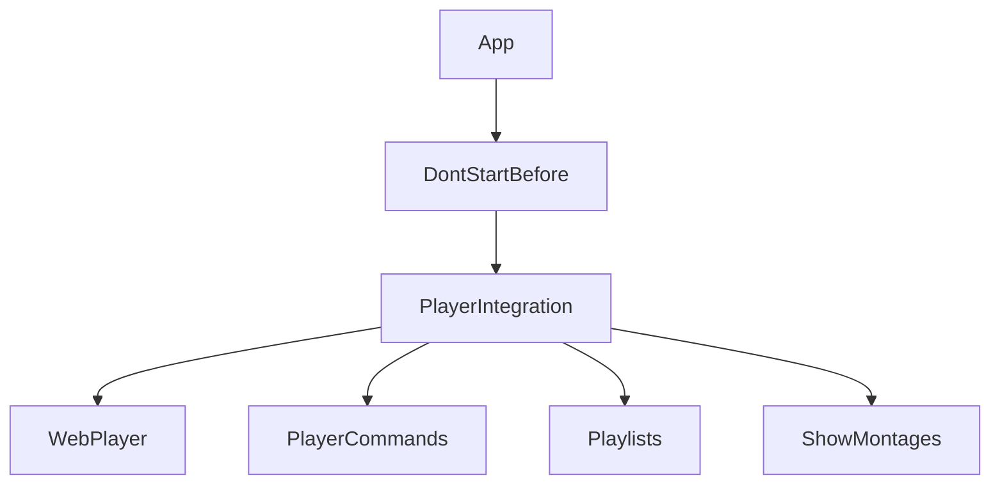

# WallMuse Player Container Architecture

## 1. Core Context Providers



## 2. Data Flow Hierarchy

```
SessionContext (User/House)
└── EnvironmentsContext (Devices/Screens)
    └── PlaylistsContext (Content)
        └── PlaylistContext (Individual Playlist State)
            └── UIContext (UI State)
```

## 3. Key Components

### SessionContext (`src/contexts/SessionContext.js`)
- User authentication and session state
- Account types: Demo, Guest, Free, Premium
- House information storage
- Flags: `isLoggedIn`, `isDemo`, `isPremium`

### EnvironmentsContext (`src/contexts/EnvironmentsContext.js`)
- Device and screen management
- Playlist synchronization
- Current playlist state
- Environment setup/cleanup

### PlaylistsContext (`src/contexts/PlaylistsContext.js`)
- Playlist data management
- Loading and updates
- State provision to components

### PlaylistContext (`src/Playlists/contexts/PlaylistContext.js`)
- Individual playlist operations
- Save/delete states
- UI feedback

## 4. Component Structure



## 5. Account Structure

```
Account
└── Houses (one house currently)
    └── Environments (devices: PC, mobile, etc.)
        └── Screens (PC: multiple possible, Web: one per browser)
```

**Account Types**:
- **Demo**: Limited functionality, no permissions
- **Guest**: Upgradeable to full account
- **Free / Premium**: Full access (freemium model)

### 5.1 Session token format

Every account is identified by a session token injected into `data-user` on the `#root` div:

```
wp-{login}-{domainId}-{md5(login + domainId + secret)}
```

Examples:
- `wp-freeaccount-1-9360c44…`   → guest on wallmuse.com / sharex (domain 1)
- `wp-Unregistered-8-0220ca…`   → guest on ooo2 (domain 8)
- `wp-Education1071-1-…`         → logged-in WP user on wallmuse.com
- `wp-mymuseum-42-abc123…`       → WP plugin customer (token from `authenticate_with_key`)

`getUserId()` in `Utils.js` reads this token from the DOM. It is the single source of truth for who is using the player — there is no separate login call at startup.

### 5.2 How the session reaches the DOM

There are two separate tracks:

**Platform sites (wallmuse.com, ooo2, sharex)**
- `common0.php` (neve-child-master theme) handles the session:
  - Logged-in WP user → token computed locally: `wp-{login}-{domain}-{md5(…)}`
  - Not logged in → `$defSessionId` (a hardcoded guest token per site, set by URL check)
- `wm_v4_player.php` injects the result into `data-user`
- The React build (`build-ok.sh`) deploys JS/CSS to `play-v4-assets/` on the same server

**WP Plugin customers (museum.org, etc.)**
- Plugin admin enters an API key in WP Settings → WallMuse
- `auth.php` → `wallmuse_get_token()` calls `authenticate_with_key` on the Java manager
- `shortcode.php` injects the returned token into `data-user`
- JS/CSS is loaded from `https://wallmuse.com/cdn/wm_player/` (`release-cdn.sh`)
- `common0.php` and `wm_v4_player.php` are **not involved**

### 5.3 Account types and demo detection

| Login contains | Detected as | Effect |
|---|---|---|
| `demo` | demo | `isDemoHouse()` → no broadcast sync sent (Java) |
| `freeaccount` | demo | same |
| `unregistered` | demo | same |
| anything else + `plugin_tier = wm-plugin-free` | demo | same |
| normal login, `plugin_tier` = pro/studio/null | live | full sync |

**JavaScript** (`isDemoAccount()` in `api.js`): checks `"Unregistered"` and `"freeaccount"` in the session token — skips house creation and backend calls for guest sessions.

**Java** (`isDemoHouse()` in `WebServiceCommands.java`): checks `demo`, `freeaccount`, `unregistered` (case-insensitive) on the account login, plus `wm-plugin-free` tier — blocks broadcast sync for all matched accounts.

### 5.4 Guest session map (platform sites only)

`getDomainGuestAccountId()` in `api.js` maps domain numbers to their hardcoded guest tokens:

```js
1 → wp-freeaccount-1-…   // wallmuse.com and sharex
8 → wp-Unregistered-8-…  // ooo2
```

This is **only used by the platform sites**. WP plugin sites never call this — their guest session is already in `data-user` when the page loads.

When a new platform site is added, add its `$defSessionId` in `common0.php` and mirror the domain → token entry here.

### 5.5 Demo accounts for WP plugin customers

A plugin customer who wants anonymous visitors to see a sample montage:

1. Creates a wallmuse.com account whose login contains `demo` or `freeaccount` (e.g. `demo_mymuseum`)
2. Gets the API key from `wallmuse.com/my-wallmuse-account/`
3. Enters that key in WP Settings → WallMuse (same field as their main account)

The login name causes both Java and the React player to treat the session as passive — no sync commands are sent, no permission popups appear.

## 6. Data Hierarchy

```
Playlist
└── Montages (sequenced array)
    └── Tracks (sequenced multigraph)
        └── Artworks (VID, IMG, AUD, HTML, TEXT)
```

**Playlist Properties**:
- `id`, `name`, `montages[]`
- `random`: false (default)
- `loop`: false (default)
- Autoplay enabled by default

## 7. Parent-Child Architecture

### Parent (React Container)
- **Location**: WordPress site
- **Responsibilities**: Environment/screen creation via REST API
- **State**: React Context (EnvironmentsContext)
- Creates environments with `crypt_key`

### Child (TypeScript WebPlayer)
- **Location**: Embedded iframe
- **Responsibilities**: Media playback, WebSocket connection
- **State**: Global variables, WebSocket state
- Reads `crypt_key` to establish WebSocket

### Communication
**Parent → Child**:
- URL parameters: `environ`, `screen`, `house`, `session`
- Global variables: `SELECTED_MONTAGE`, `SELECTED_TRACK`
- Events: `webplayer-navigate`

**Child → Parent**:
- Events: `webplayer-fully-ready`
- WebSocket status updates

**Key Point**: Parent cannot retrieve `crypt_key` from database. WebSocket connections are child-only.

## 8. Environment/Screen Management

### Environment States
- Active: `alive === "1"`
- Inactive: `alive === "0"`

### Screen States
- Active: `on === "1"`
- Inactive: `on === "0"`

### Process
1. Parent creates environment → Backend stores `crypt_key`
2. Parent creates screen → Links to environment
3. Parent activates screen → Sets dimensions
4. Child reads `crypt_key` → Generates WebSocket key
5. Child connects via WebSocket

**Rules**:
- One active environment at a time (prevents conflicts)
- Active environments must have at least one screen
- Screens can be inactive (`on === "0"`) but still valid

## 9. Navigation System

Uses **NavigationManager** (`src/utils/NavigationManager.js`) for parent-child coordination.

See [ENHANCED_NAVIGATION_SOLUTION.md](./ENHANCED_NAVIGATION_SOLUTION.md) for details.

**Key Features**:
- Queue-based command system
- Deduplication logic
- Re-render awareness
- Player readiness coordination

## 10. State Management

See [PLAYER_CONTAINER_STATE_MANAGEMENT.md](./PLAYER_CONTAINER_STATE_MANAGEMENT.md) for patterns.

**Critical Rules**:
- Use functional setState: `setState(current => ...)`
- Complete useMemo/useCallback dependencies
- Send empty params to backend (use `!== undefined` checks)
- Use index-based operations for duplicates

## 11. Troubleshooting

See dedicated troubleshooting docs:
- [PLAYER_CONTAINER_TROUBLESHOOTING.md](../troubleshooting/PLAYER_CONTAINER_TROUBLESHOOTING.md)
- [TROUBLESHOOTING_ACCOUNT_CREATION.md](../troubleshooting/TROUBLESHOOTING_ACCOUNT_CREATION.md)
